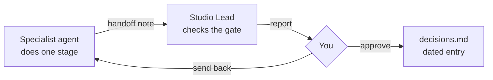

# Studio Agents

A ten-agent design and product team for Claude Code. The agents work only when you call them, and a stage closes only when your approval is on record.

[Türkçe özet](README.tr.md)

## Why this exists
Most agent teams are pipelines: you describe a goal and the agents hand the work to each other. This one does the opposite. Nothing runs until you name an agent, every agent does one stage and stops, and the only thing that moves a project forward is a line in `decisions.md` that you approved yourself.

The reason is simple. An agent can produce a plausible answer to almost anything, and a second agent that starts from the same assumptions can confirm it. So the team keeps three things apart:

- **The work.** Nine specialist agents, one stage each.
- **The audit.** Studio Lead checks the process and never does specialist work.
- **The approval.** Yours, recorded with a date, never relayed by an agent.

## Start with your own rules
The team works from one file that you write: `studio/house_rules.md`. It holds the design decisions you make the same way every time, each with a reason and a way to check it. Every agent reads it before it starts, reviewers check deliverables against it, and no agent can edit it.

It ships with four starter rules (do not invent new values; every animation has a reduced-motion alternative; mistakes go on record; do not invent the owner's experience) and an empty known issues log. Keep them, change them, or delete them, then add one of your own. If a rule is hard to write, that is worth knowing: the decision may still be a habit.

## The team
| Agent | Stage | Delivers | Model |
|---|---|---|---|
| `studio-lead` | all | Status, gate checks, handoff reviews, the next step. Controls the process, not the craft | sonnet |
| `scoping-analyst` | 1 Scoping | Scope, MVP cut, duration range, fit to your constraints | opus |
| `researcher` | 2 Research | Competitor and user report in seven phases (A to G), with sources and sample sizes | opus |
| `ux-architect` | 3a UX | UX decisions, personas, flows, IA, decision trees, wireframes in Figma. Also reviews the screens: critique and heuristic evaluation | opus |
| `brand-strategist` | 3b Brand | Brand audit, positioning, identity directions, guidelines, visual style brief | sonnet |
| `design-system-builder` | 4 Design system | Variables, styles, components and documentation in Figma. Also reviews the screens: accessibility and system conformance | sonnet |
| `ui-designer` | 5 Screens | Final screens and prototype in Figma, from approved wireframes and the system | sonnet |
| `case-study-writer` | 6 Case study | The project write-up, from verified outputs only | sonnet |
| `product-manager` | outside the pipeline | MVPs, roadmap, feature briefs, experiments | opus |
| `release-manager` | outside the pipeline | iOS App Store readiness: audit, listing, privacy answers, legal drafts. It never submits | opus |

Why each agent uses its model is in `studio/model_policy.md`.

## Quick start
You need Claude Code. Figma is optional; only three agents use it.

```bash
git clone https://github.com/imalsovolkan/studio-agents.git
cd studio-agents
claude
```

Then, inside Claude Code:

```
/agents
@agent-studio-lead status for projects/example-app
```

`/agents` should list ten agents. The status call reads a small fictional project and tells you where it stands. `studio/first_run.md` walks through the rest: your first rule, plan first, file ownership, the guard, the log, and closing a stage.

To start your own product: `@agent-studio-lead new project <name>`.

## How a stage closes


A stage is done only when its deliverable file exists, its open questions are listed, and your approval is recorded in `decisions.md`. Decisions are never deleted: a wrong or premature entry is marked `Revoked` or `Superseded` and a new one replaces it.

The Screens stage has one more condition. Two agents that did not make the screens review them first: the UX Architect (critique against the brief, the decisions and your house rules, plus a heuristic evaluation) and the Design System Builder (accessibility and system conformance). Every finding has a severity, the UI Designer answers each one, and a Blocker closes only when it is fixed or when you accept it in `decisions.md`.

## The rules
All of them are in `CLAUDE.md`. These eight shape everything else:

1. Agents run only when you name one. No agent starts another agent.
2. One agent, one stage, one defined output, then a handoff note.
3. Plan first: an agent posts a short plan and waits for your go-ahead.
4. Each agent writes only its own stage folder. Only Studio Lead or the main session writes `project_state.md` and `decisions.md`, after you approve.
5. An approval relayed by another agent is not an approval.
6. Never invent facts, numbers, quotes or results. Assumptions are marked `[Assumption]`, unverified facts `[Unverified]`.
7. Every agent reads `studio/house_rules.md` first and follows it.
8. Nobody reviews their own work.

### What is enforced and what is guidance
| Rule | How it holds |
|---|---|
| No agent starts another agent | Enforced: no agent has the `Agent` tool |
| Only Studio Lead writes the two state files | Enforced by `.claude/hooks/guard_state_files.py` (a PreToolUse hook), on top of the rule in each agent |
| No agent edits your house rules | Enforced by the same hook |
| Agents have no shell, and secrets are unreadable | Enforced: no agent has `Bash`; `.claude/settings.json` denies `.env`, `secrets/`, `~/.ssh` and `~/.aws` |
| Web access and Figma writes need your confirmation | Enforced: `ask` rules in `.claude/settings.json` |
| Agents run only when you name one | Guidance: stated in every agent description and in `CLAUDE.md`. Claude Code has no switch that turns automatic delegation off for a subagent |
| Nobody reviews their own work | Guidance: stated in the reviewers and the UI Designer; Studio Lead checks it at the gate |
| Plan first, honesty labels, one stage per call | Guidance: stated in every agent |

## Studio Lead commands
`status` · `gate check [stage]` · `next` · `handoff review` · `review status` · `close stage [stage]` · `context audit` · `new project` · `risk scan` · `add rule`

Example: `@agent-studio-lead gate check research for projects/my-app`

## Folder layout
```
CLAUDE.md                     rules for every session
.claude/agents/               the ten agents
.claude/hooks/                event log, and the guard for state and rule files
.claude/settings.json         permissions and hooks
.mcp.json                     Figma connection (optional)
studio/house_rules.md         your own rules and the known issues log
studio/00_studio_flow.md      stages, gates, reviews, parallel work, Figma safety rules
studio/templates/             project_state, decisions, handoff_note, review_note, context_pack, constraints, release_checklist
studio/model_policy.md        which model each agent uses and why
studio/first_run.md           six checks for a new setup
studio/pilot_checklist.md     what to test in Figma before real work
studio/optional_skills.md     third-party skills the agents can use
projects/example-app/         a fictional project to try the commands on
```

## Make it yours
- **Language.** Change `Owner language:` in `CLAUDE.md`. Reports and chat follow it; product-facing text follows the product language in `project_state.md`.
- **Models.** One line per agent file (`model:`). See `studio/model_policy.md`.
- **Figma.** `.mcp.json` points at Figma's remote MCP server. Run `/mcp` and authenticate, then run `studio/pilot_checklist.md` before real work. If you do not use Figma, delete `.mcp.json`; the seven text agents work without it.
- **Constraints.** Fill in `studio/templates/constraints.md` if the Scoping Analyst should check scope against your time and capacity.
- **Skills.** None are bundled. See `studio/optional_skills.md`.
- **Parallel work.** Off by default. See "Parallel work" in `studio/00_studio_flow.md` and `.claude/settings.teams.example.json`.

## Event log
Hooks append one line per subagent start and stop to `.claude/logs/agent_events.jsonl` (ignored by git). They never block anything. The log shows which agent ran and how long each call took.

## Known limits
- "Run only when asked" is guidance, not an enforced switch.
- The guard hook was written against the documented hook input and tested with simulated input only. Run check 3 in `studio/first_run.md` in your own setup.
- Reviews are done by agents from the same model family as the maker, so they can share its blind spots. They catch omissions and broken rules; they do not replace testing with people.
- Agent and hook behaviour follows the Claude Code documentation as checked on 2026-11-23; the permission rule syntax in `.claude/settings.json` was checked on 2026-11-02. Re-check after Claude Code updates.
- The hooks call `python3`. If your Python command is `python`, change it in `.claude/settings.json`.
- The Figma agents depend on what Figma's MCP server allows your account to do. The pilot checklist exists for that reason.
- Agents can check that work is consistent, sourced and complete. They cannot tell you whether it is good. That judgment stays with you.

## Licence
MIT. See `LICENSE`.
